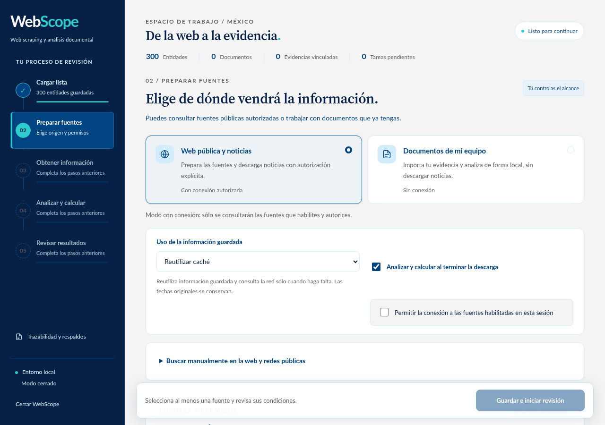

# De la lista al scoring

La interfaz de WebScope 2.9.0 guía el trabajo en cinco pasos. La barra lateral indica
qué terminó, qué está activo y qué falta. Los botones muestran el motivo cuando
una acción todavía no está disponible.

La [vista móvil](images/flujo-2-9-movil.png) conserva el mismo recorrido con un
selector de pasos y controles adaptados a la pantalla.

## 1. Cargar lista

Agregue un nombre o seleccione **Lista CSV o tabla**. En un archivo, identifique
las columnas, revise los tipos y confirme la vista previa. **Guardar y continuar**
conserva las entidades y abre el paso de fuentes. Guardar no busca noticias ni
calcula resultados. Las pistas de identidad siguen pendientes de verificación.

## 2. Preparar fuentes

Elija uno de los dos recorridos:

- **Noticias en línea:** habilite las fuentes cuyas condiciones haya revisado.
  Los permisos para leer un feed y conservar el cuerpo son independientes.
  Configure el alcance y pulse **Guardar e iniciar**. Puede filtrar el catálogo
  por nombre y explorar más fuentes sin recorrer todas las tarjetas.
- **Documentos locales:** use información ya incorporada al banco, sin descarga
  de internet. Confirme ese alcance. Si no hay documentos, el resultado indicará
  la falta de evidencia; no se presentará como una búsqueda completada.

**Consultar** registra que revisó las condiciones de esa fuente; **Conservar texto**
registra por separado el permiso para sus cuerpos editoriales. Los buscadores
que sólo ofrecen referencias no muestran un permiso ficticio de cuerpo.
Las fuentes empiezan deshabilitadas; elegir el modo online no las autoriza.
El botón principal espera a que termine de guardarse cualquier cambio de permisos.

En **Búsqueda dirigida e histórica**, elija el período, el enfoque y el presupuesto
de consultas. El plan se prepara localmente: no conecta con las fuentes ni calcula
scores. Revise sus avisos antes de iniciar. El período solicitado puede ser
mayor que el historial accesible de una fuente. Consulte la
[guía de búsqueda y recuperación](RECUPERACION_DESCARGA.md).

## 3. Descargar noticias

Elija cómo usar las copias guardadas:

- **Reutilizar caché:** aprovecha respuestas vigentes antes de consultar internet.
- **Comprobar cambios:** revalida las URLs que procesa el lote, con peticiones
  condicionales cuando la fuente las admite.
- **Sólo caché local:** consulta lo ya conservado sin DNS ni conexiones a internet.
  Una copia antigua conserva su fecha; un enlace sin copia queda pendiente.

Autorice la conexión para los dos primeros modos. El sistema muestra las
tareas realmente terminadas y el tiempo transcurrido. Al descubrir enlaces puede
aumentar el trabajo pendiente; mientras no se conoce el total, la barra es
indeterminada y no promete un porcentaje ni un tiempo de finalización.

**Pausar** solicita detener el lote. Una petición que ya está en curso puede
necesitar terminar antes de que el estado cambie a **En pausa**. Hasta entonces
se mantienen los bloqueos. **Reanudar** trabaja sobre la cola conservada.

Un límite de tiempo, un aplazamiento o un error no convierten la adquisición en
completa. El panel distingue tareas listas, aplazadas, activas y fallidas; muestra
la causa de la pausa y el próximo intento permitido cuando se conoce.
El panel distingue peticiones de red, reutilizaciones de caché, cuerpos nuevos
y reutilizados y candidatos duplicados. Los contadores corresponden a la sesión
identificada; una métrica no disponible aparece como **—**. Abra **Detalle de tareas**
para filtrar estados e inspeccionar errores. Un reintento individual conserva
las pausas del proveedor y no inicia una descarga por sí mismo.

Si quedan tareas pendientes y ya no hay trabajadores activos, elija entre
**Reanudar descarga** y **Analizar lo disponible**. La segunda opción
registra la decisión explícita e inicia el análisis parcial en una sola acción. No borra noticias,
no elimina la cola y no marca esos trabajos como terminados. La evaluación guarda
cuántas tareas quedaron pendientes y qué información estaba disponible. Reanudar
después invalida el resultado vigente hasta volver a analizar. Los metadatos de un
feed o buscador siguen sin ser el cuerpo de una noticia ni evidencia puntuable.

En el recorrido local este paso explica que no se solicita una descarga y permite
continuar con el alcance confirmado.

## 4. Analizar y calcular

El cálculo empieza al pulsar **Analizar y calcular**, **Analizar lo disponible**
o al terminar una adquisición completa si eligió **Analizar al terminar**.
La continuación automática se detiene cuando hay pendientes o limitaciones que
requieren aceptar expresamente la cobertura disponible. Primero se
atribuyen noticias y menciones al banco; después se calculan las entidades. Las
fases muestran contadores de artículos o entidades ya procesados y guardados.
Una estimación de tiempo aparece cuando hay suficientes unidades y tiempo medidos
para calcularla. Es aproximada y puede cambiar si los documentos restantes son
más costosos de analizar.

Durante una descarga o un análisis no se pueden importar más datos, cambiar
fuentes, iniciar otro cálculo, guardar revisiones ni exportar resultados vigentes.
Estos controles se aplican también a peticiones directas a la API. Recargar la
página u abrir otra pestaña consulta la misma operación; no crea otro trabajo.

## 5. Revisar resultados

Abra una entidad para ver el score, los factores, las citas y las exclusiones.
Consulte la evidencia original antes de confirmar una revisión. Los históricos
siguen disponibles sin recalcularlos. La exportación se habilita cuando el análisis
de los datos vigentes está completo.

Agregar entidades, modificar fuentes, incorporar documentos o cambiar revisiones
puede invalidar los resultados del proceso anterior. El sistema conserva los
históricos y exige completar nuevamente los pasos afectados. Un trabajador externo
activo también impide analizar o cerrar cobertura. Una cola inactiva puede quedar
fuera del análisis sólo mediante el cierre parcial explícito; en modo local no
impide analizar los documentos locales confirmados.

## Estados y tiempo restante

| Estado | Qué significa |
| --- | --- |
| Pendiente | Falta un requisito; el motivo aparece junto a la acción. |
| Listo | Se puede iniciar el paso. |
| En curso | Existe una operación activa; se muestran sus unidades guardadas. |
| Pausa solicitada | Se espera la salida segura del trabajo en curso. |
| En pausa | El lote se detuvo; pueden quedar tareas que reanudar. |
| Requiere atención | Se produjo un error; no se anuncia finalización correcta. |
| Completado | El paso terminó para los datos y alcance vigentes. |

El tiempo restante se muestra por fase y por etapa de cada tarea activa. Para una
fase se usa el rendimiento de esta sesión tras al menos tres unidades y tres
segundos medidos, o muestras anteriores conservadas en el mismo equipo. Antes de
la primera muestra aparece **Calculando estimación**; una previsión superada se
reajusta. Las esperas de fuentes indican el próximo intento permitido y se
separan del procesamiento. La descarga puede descubrir nuevas tareas y carecer
de un total global estable. El detalle y la validación están en
[VALIDACION_2_5_0.md](VALIDACION_2_5_0.md).
