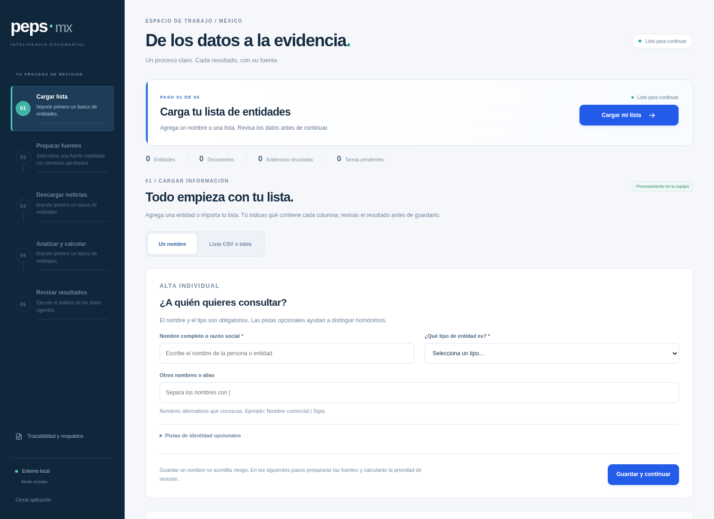

# De la lista al scoring

La interfaz de PEPS MX 2.3 guía el trabajo en cinco pasos. La barra lateral indica
qué terminó, qué está activo y qué falta. Los botones muestran el motivo cuando
una acción todavía no está disponible.

La [vista móvil](images/flujo-guiado-movil.png) conserva el mismo recorrido con un
selector de pasos y controles adaptados a la pantalla.

## 1. Cargar lista

Agregue un nombre o seleccione **Lista CSV o tabla**. En un archivo, identifique
las columnas, revise los tipos y confirme la vista previa. **Guardar y continuar**
conserva las entidades y abre el paso de fuentes. Guardar no busca noticias ni
calcula resultados. Las pistas de identidad siguen pendientes de verificación.

## 2. Preparar fuentes

Elija uno de los dos recorridos:

- **Noticias en línea:** habilite las fuentes cuyas condiciones haya revisado.
  Los permisos para leer un feed y conservar el cuerpo son independientes.
  Confirme la selección antes de continuar.
- **Documentos locales:** use información ya incorporada al banco, sin descarga
  de internet. Confirme ese alcance. Si no hay documentos, el resultado indicará
  la falta de evidencia; no se presentará como una búsqueda completada.

Cambiar los permisos, las fuentes o el modo requiere confirmar nuevamente la
selección. Las fuentes empiezan deshabilitadas; elegir el modo online no las
autoriza por sí solo.

## 3. Descargar noticias

Autorice la conexión de la sesión e inicie la descarga. El sistema muestra las
tareas realmente terminadas y el tiempo transcurrido. Al descubrir enlaces puede
aumentar el trabajo pendiente; mientras no se conoce el total, la barra es
indeterminada y no promete un porcentaje ni un tiempo de finalización.

**Pausar** solicita detener el lote. Una petición que ya está en curso puede
necesitar terminar antes de que el estado cambie a **En pausa**. Hasta entonces
se mantienen los bloqueos. **Reanudar** trabaja sobre la cola conservada.

Un límite de tiempo, un aplazamiento o un error no convierten la adquisición en
completa. Si quedan tareas pendientes, reanude la descarga. Cuando la adquisición
terminó y sólo conserva cobertura parcial, la interfaz permite aceptarla de forma
explícita antes de analizar. Esa aceptación no oculta errores ni convierte
metadatos de un feed en el cuerpo de una noticia.

En el recorrido local este paso explica que no se solicita una descarga y permite
continuar con el alcance confirmado.

## 4. Analizar y calcular

El cálculo empieza únicamente al pulsar **Analizar y calcular**. Primero se
atribuyen noticias y menciones al banco; después se calculan las entidades. Las
fases muestran contadores de artículos o entidades ya procesados y guardados.
Una estimación de tiempo aparece cuando hay suficientes unidades y tiempo medidos
para calcularla. Es aproximada y puede cambiar si los documentos restantes son
más costosos de analizar.

Durante una descarga o un análisis no se pueden importar más datos, cambiar
fuentes, iniciar otro cálculo, guardar revisiones ni exportar resultados vigentes.
Estos controles se aplican también a peticiones directas a la API. Recargar la
página u abrir otra pestaña consulta la misma operación; no crea otro trabajo.

## 5. Revisar resultados

Abra una entidad para ver el score, los factores, las citas y las exclusiones.
Consulte la evidencia original antes de confirmar una revisión. Los históricos
siguen disponibles sin recalcularlos. La exportación se habilita cuando el análisis
de los datos vigentes está completo.

Agregar entidades, modificar fuentes, incorporar documentos o cambiar revisiones
puede invalidar los resultados del proceso anterior. El sistema conserva los
históricos y exige completar nuevamente los pasos afectados. Un trabajo externo
con descargas pendientes también impide presentar un resultado como vigente.

## Estados y tiempo restante

| Estado | Qué significa |
| --- | --- |
| Pendiente | Falta un requisito; el motivo aparece junto a la acción. |
| Listo | Se puede iniciar el paso. |
| En curso | Existe una operación activa; se muestran sus unidades guardadas. |
| Pausa solicitada | Se espera la salida segura del trabajo en curso. |
| En pausa | El lote se detuvo; pueden quedar tareas que reanudar. |
| Requiere atención | Se produjo un error; no se anuncia finalización correcta. |
| Completado | El paso terminó para los datos y alcance vigentes. |

El tiempo restante se estima por fase, a partir de al menos tres unidades y tres
segundos medidos. Si no hay total conocido o muestra suficiente se muestra
**aún no estimable**. Las demoras de fuentes externas no se sustituyen por una
cuenta regresiva simulada.
