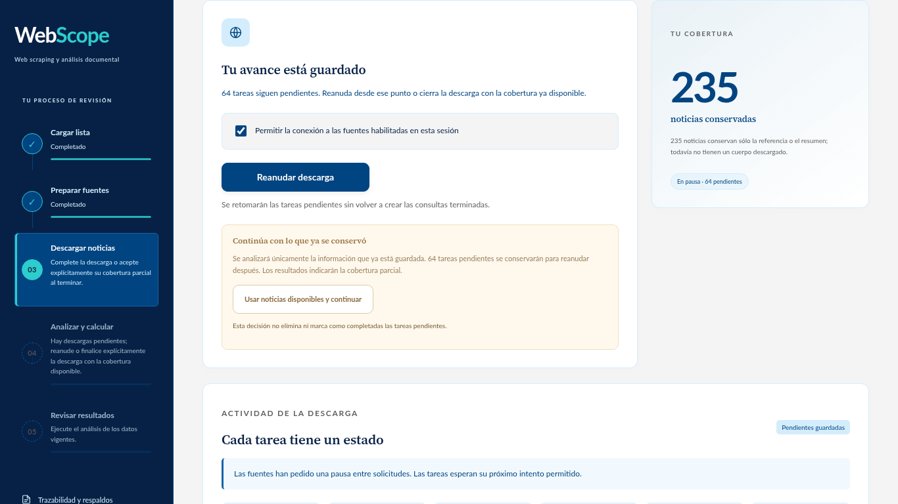

# Recuperar una descarga y buscar por entidad

WebScope 2.4.0 corrige el caso en que la adquisición se detenía con noticias ya
guardadas y tareas pendientes, sin permitir llegar al análisis. La cola y las
noticias se conservan; no es necesario volver a importar el banco.

La [vista móvil](images/descarga-recuperable-movil.png) ofrece las mismas acciones.
Las capturas usan información ficticia de la prueba de recuperación.

## Actualizar sin perder información

Cierre la versión anterior y extraiga el paquete nuevo en otra carpeta. Mantenga
juntos `WebScope.exe`, `WebScope-CLI.exe` y `_internal`. Abra el ejecutable nuevo
con la misma ubicación de datos que usaba antes. Sin `--data-dir`, Windows sigue
utilizando `%LOCALAPPDATA%\PEPS-MX`. Si indicaba una ruta al iniciar, conserve esa
misma ruta. No borre la base de datos ni la carpeta de datos para actualizar.

## Si aparecen noticias guardadas y tareas pendientes

1. Abra el paso **Descargar noticias**. Revise actividad, tareas completadas,
   listas, aplazadas y fallidas. El panel explica por qué se detuvo la sesión y
   cuándo se permite el próximo intento, si se conoce.
2. Para conseguir más información, autorice la conexión de la sesión y pulse
   **Reanudar descarga**. Esta acción procesa la cola existente; no vuelve a
   generar las consultas terminadas. Los reintentos respetan las pausas de las
   fuentes. Una fuente que responde con una restricción no se presenta como
   descargada correctamente.
3. Para trabajar con lo obtenido, espere a que no haya ningún trabajador activo
   y pulse **Usar noticias disponibles y continuar**. Esta decisión cierra la
   descarga con cobertura parcial y conserva tanto
   las noticias como las tareas pendientes y abre el paso de análisis. No afirma
   que la investigación esté completa.
4. Pulse **Analizar y calcular**. La atribución y el cálculo muestran sus propias
   unidades procesadas. La explicación de cada evaluación conserva los límites
   de la adquisición utilizada, incluidas las tareas que quedaron sin completar.

Si una solicitud sigue en curso, **Pausar descarga** solicita su salida segura.
La interfaz espera la respuesta o el timeout antes de habilitar otra operación.
Un trabajador externo con un lease vigente mantiene el mismo bloqueo. Recargar
el navegador consulta el estado existente y no inicia otra descarga.

Después de reanudar, los resultados anteriores permanecen en el historial; el
resultado vigente requiere analizar nuevamente la información incorporada. Las
tareas agotadas pasan a fallo explícito en lugar de quedar como pendientes
imposibles de procesar. Reintentar errores es una acción independiente.

## Preparar consultas útiles

En **Preparar fuentes**, configure la búsqueda antes de confirmar el paso:

- **Dirigida por entidad:** usa nombres exactos y, si los habilita, alias. Puede
  añadir consultas con pistas de cargo, estado o municipio. Estas pistas ayudan
  a encontrar candidatos; no prueban identidad.
- **Enfoque:** todas las noticias, actividad pública y trayectoria, o señales
  adversas para revisión. El enfoque general evita limitar la búsqueda sólo a
  noticias negativas.
- **Período y ventanas:** indique fechas de inicio y fin. El plan divide el
  período en ventanas para reducir la dependencia de los resultados más
  recientes. Una fuente puede tener un alcance menor que el solicitado.
- **Presupuesto de consultas:** limita el trabajo del lote. Si no alcanza para
  todas las entidades o ventanas, el plan lo avisa. Aumentarlo aumenta el trabajo
  real; no garantiza un número de noticias por persona.
- **Feeds generales:** es un recorrido separado para conservar la edición
  disponible de los medios. Un feed general no equivale a una investigación
  histórica de las personas cargadas.

Guardar y revisar el plan no conecta con internet. Confirme las fuentes y sus
permisos y después autorice la conexión de la sesión en el paso de descarga.
Las fuentes nuevas empiezan deshabilitadas y la actualización conserva las
elecciones existentes.

El catálogo incluye **Desinformémonos: archivo por entidad y fecha**. Una consulta
pública por «López Obrador» y el año 2020 devolvió diez notas con fechas de ese
año. El adaptador divide ventanas saturadas por año, mes y día. Ese resultado
verifica el funcionamiento del adaptador, no que el medio cubra a todas las
personas cargadas. El buscador sigue siendo un índice limitado del editor.

Google News RSS queda fuera del plan automático por el bloqueo publicado en su
`robots.txt`; que un endpoint responda no significa que el colector pueda usarlo.
GDELT complementa la cobertura reciente. El plan indica cuántas entidades y
consultas incluye, muestra ejemplos de las búsquedas y avisa cuando el presupuesto
deja ventanas fuera. Si el plan no tiene ninguna consulta, vuelva a preparar
fuentes: el sistema no inicia una descarga vacía ni la anuncia como terminada.

## Qué significa el progreso

Los contadores provienen de trabajos guardados en SQLite. Cuando una consulta
descubre más enlaces, el trabajo pendiente puede crecer. Durante esa fase la
barra puede ser indeterminada. Una espera por dominio o un reintento aplazado
muestra su causa; el tiempo restante de procesamiento no sustituye esa espera.
Una sesión de interfaz programa trabajo durante un máximo de quince minutos o
diez mil intentos, conservando la cola si alcanza alguno de esos límites. Las
peticiones que ya salieron terminan con su timeout de transporte.

El número de noticias no equivale al número de artículos leídos: el panel y la
evaluación distinguen cuerpos conservados de metadatos y referencias. Un
resultado de búsqueda sin cuerpo no puntúa como evidencia del artículo. GDELT
DOC ofrece una ventana reciente de hasta tres meses, no un archivo de diez años.
Una consulta histórica sigue dependiendo del índice y de los límites de cada
fuente; no se anuncia un archivo completo.
