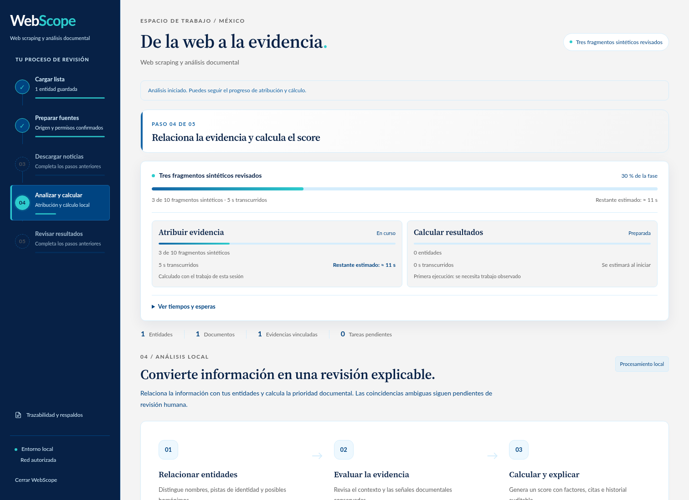

# Rendimiento, progreso y usabilidad 2.5.0

WebScope 2.5.0 reduce trabajo repetido en el navegador, la cola y la consulta de
resultados. Conserva el recorrido de cinco pasos, la recuperación de descargas,
los permisos de fuentes, las evaluaciones históricas y sus controles de integridad.
Las pruebas y mediciones de esta revisión usan personas y documentos ficticios.

## Correcciones

- El navegador solicitaba todas las evaluaciones cada segundo en cualquier
  pestaña. Además, la respuesta duplicaba el resultado como objeto y cadena JSON.
  Ahora solicita resúmenes sólo en resultados, renueva la lista cuando cambia su
  revisión y abre la explicación íntegra bajo demanda.
- La columna interna `result` podía conservar un score anterior cuando el análisis
  vigente ya se había invalidado. La API elimina esa columna y oculta el score
  hasta completar el análisis de los datos actuales.
- Las búsquedas rápidas descartan respuestas de una consulta anterior. El polling
  es serial, agrupa refrescos simultáneos, reduce su frecuencia en reposo o con la
  ventana oculta y conserva los nodos y el foco de las filas sin cambios.
- La cola realizaba lecturas completas redundantes al reclamar trabajos. Comparte
  un agregado de disponibilidad y conserva lecturas exactas después de cada
  cierre. Los cambios externos siguen siendo visibles.
- Las consultas históricas divididas podían conservar la URL de la ventana padre.
  Cada hija recibe su URL correcta, una reserva de horario y una inserción
  atómica e idempotente. Se respetan los aplazamientos existentes.
- Una cola vacía con fallos o cancelación ya no muestra éxito ni 100 %. Si el
  resultado final corrige un callback previo, también retira su muestra de ETA.
- Abrir explicación e historial comparte una transacción y una validación de la
  cadena. Replay conserva ese mismo snapshot. Cada lectura nueva vuelve a
  comprobar la integridad; no se guarda una aprobación entre conexiones.
- Cerrar la aplicación con una consulta de estado en vuelo ya no intenta
  actualizar controles que se eliminaron al cerrar.
- Si falla un cambio de permisos, los controles recuperan su estado guardado.
  La búsqueda vacía indica que no hay coincidencias y propone corregir el texto.

## Interfaz y tiempos

Se mantienen la paleta azul y aqua, Lato y Source Serif 4 distribuidas localmente.
El texto funcional aumenta a 12–14 px y los campos móviles a 16 px. La jerarquía,
espacios, contraste y acciones de cada paso facilitan leer y continuar. Las
condiciones extensas de las fuentes se abren bajo demanda; sus permisos siguen
visibles. El detalle de fases terminadas se puede desplegar en resultados.

El seguimiento distingue la descarga, la atribución y el cálculo. Las tareas
activas muestran fuente, etapa, tiempo transcurrido y estimación de esa etapa
cuando existen observaciones. Las fases usan el rendimiento de esta sesión o
muestras anteriores del banco local. Los perfiles son pequeños, locales y se
persisten al cerrar la operación, sin escrituras por cada actualización visual.

Antes de la primera muestra se indica que el tiempo se calculará al observar
trabajo real. Si una solicitud supera su previsión, se muestra que la estimación
se reajusta. El próximo intento de una fuente es una espera programada, separada
del tiempo de procesamiento. Una búsqueda que todavía descubre enlaces no
promete una duración global ni un porcentaje con un total inventado.

## Mediciones observadas

La evidencia está en [performance_polish_2_5_0.json](benchmarks/performance_polish_2_5_0.json).
Las comparaciones corresponden al mismo host Linux compartido; no son un SLA ni
una medición de cobertura o velocidad de los medios externos.

| Operación y muestra | Antes | Después |
| --- | ---: | ---: |
| Transferencia del seguimiento de fuentes durante 30 s, 20 entidades/1.000 documentos | 472,55 MB | 40,96 KB |
| Consulta de lista, 20 entidades/1.000 documentos | 16,29 MB | 3,62 KB |
| Seguimiento del flujo, 10.000 tareas y documentos, mediana | 22,85 ms | 5,97 ms |
| Procesar 200 trabajos de una cola de 10.000, sin red, ejecución trazable | 7,63 s | 3,74 s |
| Lecturas de 20 explicaciones, 1.000 documentos, perfil comparable | 1,085 s | 0,371 s |
| Validaciones de cadena para esas 20 lecturas | 40 | 20 |
| Plan con 10.000 homónimos y todos sus IDs, ejecución trazable | 3,362 s | 0,061 s |

Los índices añaden un coste de escritura medido: insertar 10.000 trabajos pasó de
33,9 a 45,8 ms. El intercambio favorece las lecturas frecuentes del seguimiento;
las firmas y los recibos previos se comprobaron antes y después de crear índices.
El resumen de planificación se invalida cuando cambia el padrón o la configuración
y tiene una vida máxima de 30 segundos.

## Comprobaciones y capturas

La suite local completó **454 pruebas: 447 correctas y 7 opcionales de spaCy
omitidas**. Chromium aprobó 74 comprobaciones del flujo guiado, 39 de recuperación,
32 de importación y 19 de explicación y revisión. Se comprobaron fuentes locales,
ausencia de desbordamiento en móvil, doble clic, pestañas simultáneas y recarga.



[Consultar la captura de resultados en móvil](images/resultados-movil-2-5-0.png).

## Reproducir

```powershell
python -m unittest discover -s tests -v
python scripts/test_workflow_ui.py
python scripts/test_download_recovery_ui.py
python scripts/test_import_ui.py
python scripts/test_explainability_ui.py
python scripts/benchmark_ui_polling.py --tab sources --duration 30 --assert-optimized
python scripts/benchmark_explanation_reads.py --entities 20 --notes 50 --repeats 3
python scripts/benchmark_news_runtime.py --output runtime/benchmark-news-runtime.json
```

El wheel instalado en un entorno limpio aprobó 14 comandos y 16 recursos; sus
36 archivos de código y recursos comparados coinciden con el árbol validado. La
regresión de polling suma 15 comprobaciones, incluida la respuesta retenida al
cerrar.

La matriz de CI comprueba Windows y Linux con Python 3.10 y 3.12, la instalación
aislada del wheel, los flujos del navegador y el NLP opcional. El portable de
Windows se construye después de aprobar la matriz y valida los ejecutables
congelados. Las pruebas locales de esta revisión también abren un banco creado
con el wheel auténtico 2.3.1 para comprobar recuperación y replay.
