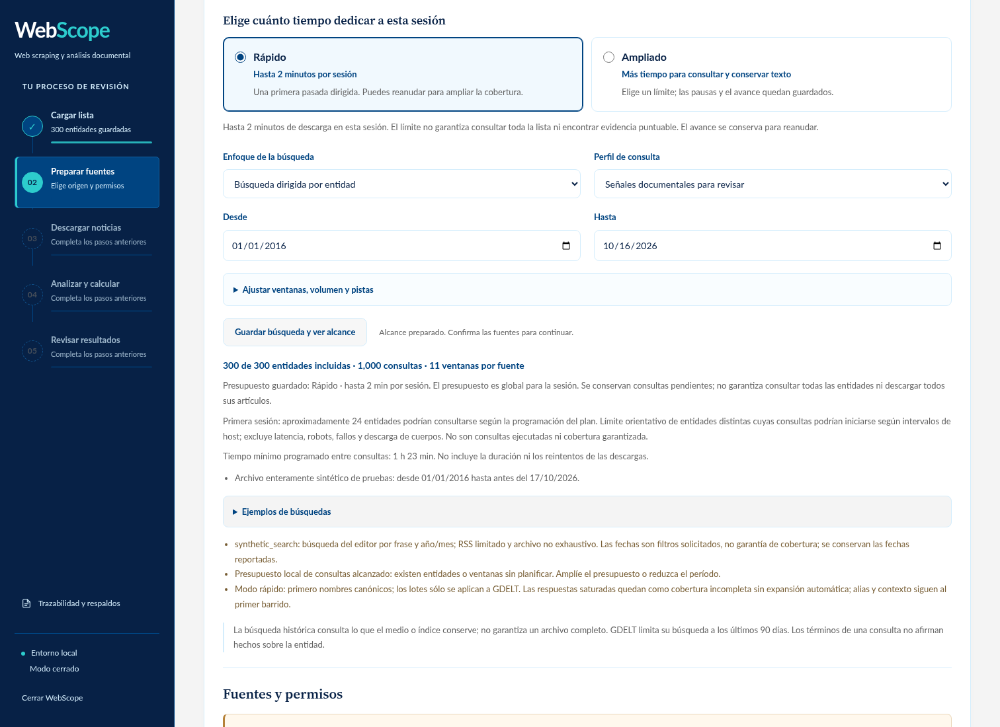
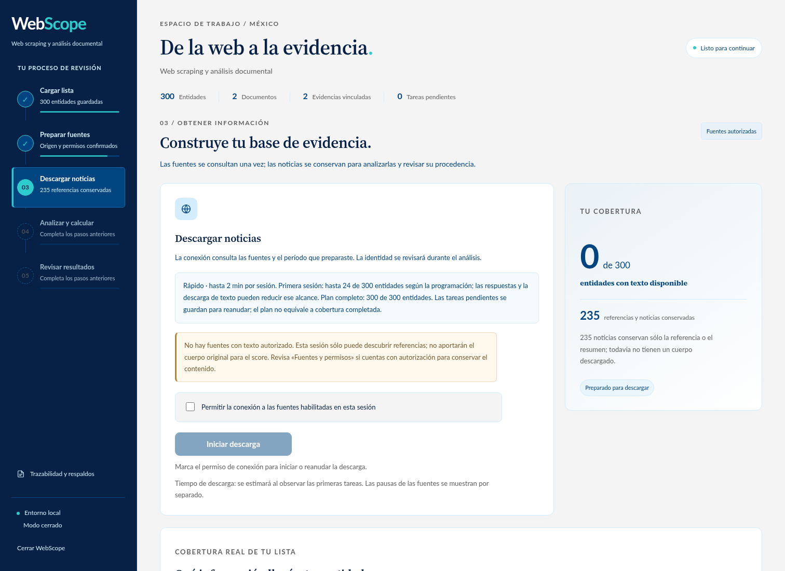

# Adquisición pertinente y presupuestos de sesión 2.6.0

La revisión aborda noticias ajenas al padrón, expansión histórica innecesaria,
colas de búsquedas anteriores y resultados cero sin información suficiente.
La [guía operativa](ADQUISICION_MASIVA.md) explica qué recorrido elegir.

## Comportamiento corregido

La adquisición construye un índice de nombres una vez por banco y filtra título
y resumen antes de guardar observaciones o encolar cuerpos. Los alias requieren
contexto. Las consultas dirigidas se comprueban contra sus entidades objetivo;
una fuente que devuelve su feed general no obtiene cobertura por ese hecho.
Una respuesta saturada sin candidatos pertinentes no se divide repetidamente.

GDELT utiliza grupos OR planos de frases dentro de sus límites. El primer barrido
reparte entidades entre fuentes y aplaza la expansión; WordPress conserva sus
consultas individuales y filtros reales de fecha. Los presupuestos de sesión se
aplican a robots y redirecciones. Los cuerpos tienen cuotas por entidad, se
rescatan candidatos anteriores y se omiten cuerpos ajenos de colas antiguas.

Al cambiar de período o perfil e iniciar una búsqueda nueva, se sustituyen las
consultas obsoletas en una transacción. Se preservan cuerpos, auditoría, reservas
activas, intentos y fechas de reintento. Reanudar mantiene el alcance previo.

La interfaz separa planificación, consultas observadas, candidatos y texto. La
falta de evidencia o identidad se muestra como **—**, con sus causas; no se
modificaron los pesos ni las reglas numéricas para producir positivos.

## Prueba reproducible de 300 entidades

La [evidencia JSON](benchmarks/mass_acquisition_2_6_0.json) conserva hashes,
configuración, controles, comparación y verificaciones del paquete. El script
usa el scheduler, SQLite, ingesta, atribución y scoring reales. Sustituye el
transporte externo por respuestas sintéticas y avanza un reloj virtual cinco
segundos por petición para representar la cortesía de una única fuente.

| Caso con 300 entidades | Antes | Después |
| --- | ---: | ---: |
| Fuente ajena, 24 consultas: observaciones guardadas | 6.000 | 0 |
| Fuente ajena: referencias incorporadas al banco | 250 | 0 |
| Mixto: observaciones guardadas | 3.750 | 16 |
| Mixto: cuerpos pertinentes obtenidos | 9 | 8 |
| Mixto con señales adversas: observaciones guardadas | 4.000 | 15 |
| Mixto con señales adversas: cuerpos pertinentes obtenidos | 8 | 9 |

La sesión virtual dura 120 segundos en ambas versiones. Los trabajadores
intercalan consultas y cuerpos en distinto orden: no se exige idéntico número
de consultas o cuerpos al alcanzar ese presupuesto. Los cuerpos pendientes se
conservan. Estos casos no miden internet ni aseguran completar los 300 nombres
en dos minutos; entre 92 % y 95 % de los nombres únicos quedan sin consulta con
una sola fuente que permite una petición cada cinco segundos.

En el caso adverso final, cinco cuerpos con identidad corroborada por anclas
sintéticas activan score 5. Cuatro cuerpos de control —dos neutros, uno negado y
uno de víctima— permanecen en cero. Los seis vínculos sólo de metadatos con frases
adversas se excluyen del cálculo. Los 300 homónimos permanecen ambiguos y sin
puntos, incluso ante un cuerpo adverso. Son controles sintéticos de corrección,
no una estimación de precisión sobre prensa real.

La simulación de planificación con dos hosts y lotes GDELT permite iniciar
consultas de hasta 144 entidades en el primer presupuesto ideal, frente a 24
antes. Es un límite de planificación: no cuenta éxito, cuerpos ni cobertura
exhaustiva. Depende de longitud de nombres, permisos, hosts y latencia.

## Fuentes públicas y compatibilidad

Se comprobó acceso técnico al RSS dirigido de Contralínea: la consulta pública
por una figura conocida devolvió seis entradas; una frase ficticia de control,
cero. La consulta por año 2020 devolvió fechas de 2020. Aristegui devolvió quince
entradas al consultar 2020; su control negativo agotó el tiempo de espera. No se
atribuye a ese control un resultado vacío verificado. Ambos robots permitieron
las rutas probadas. Esto no concede permiso editorial ni garantiza un archivo
completo: los adaptadores nuevos y todos sus permisos comienzan desactivados.

La actualización abre un banco creado por el wheel auténtico 2.3.1 y conserva
noticias, cola, permisos e historial. El wheel instalado se valida sin acceso
externo, con comandos, recursos y comparación byte a byte del código empaquetado.

## Reproducir

```powershell
python -m unittest discover -s tests -v
python scripts/test_acquisition_ui.py
python scripts/test_download_recovery_ui.py
python scripts/benchmark_mass_acquisition.py --entities 300 --seconds 120 --output runtime/benchmark-mass.json
```

El benchmark permite `--source-root` para ejecutar el mismo guion sobre otra
revisión. Devuelve error si falla algún control; no usa un umbral de latencia
para declarar que internet o las fuentes terminarán a una hora determinada.

## Verificación final local

| Comprobación | Resultado |
| --- | --- |
| Suite completa | 497 pruebas: 490 correctas y 7 opcionales de spaCy omitidas |
| Navegador y polling | 208 comprobaciones, sin errores JS ni solicitudes externas |
| Actualización real desde wheel 2.3.1 | 12 comprobaciones |
| Wheel 2.6.0 limpio | 14 comandos, 16 recursos y 38 archivos idénticos |





[Captura móvil de evaluación insuficiente](images/adquisicion-sin-evidencia-movil-2-6-0.png).
