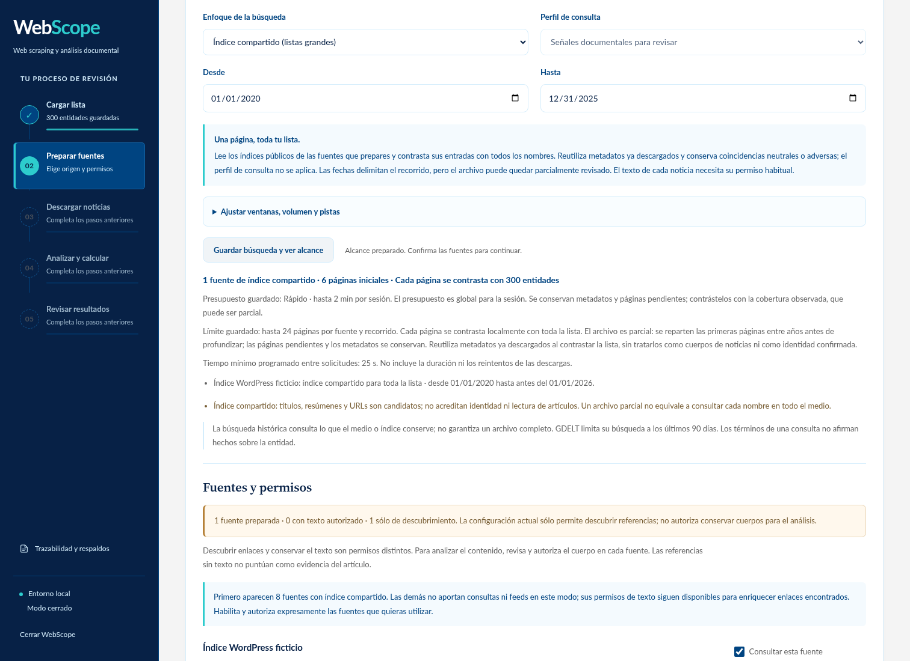
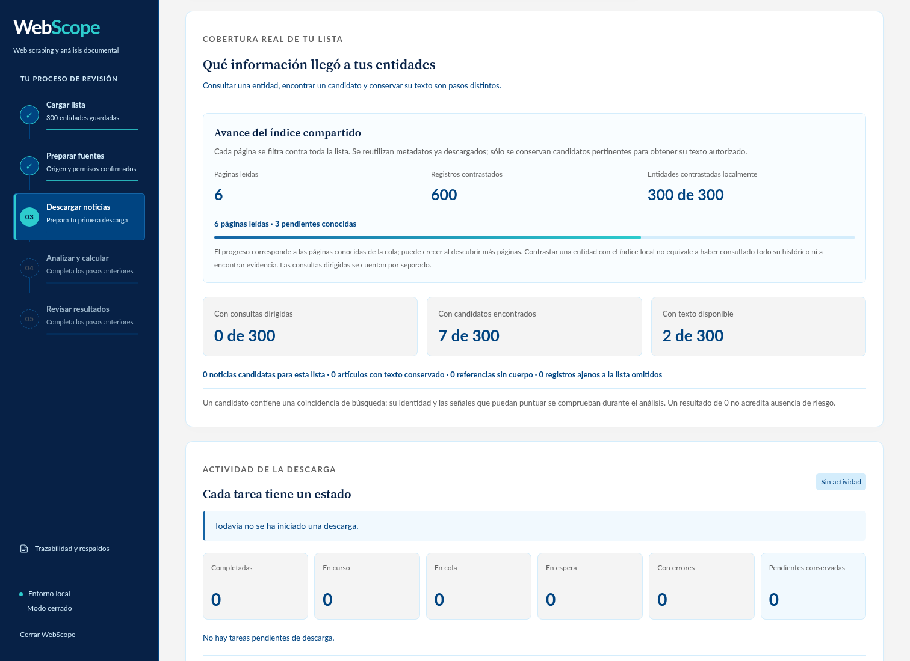

# Índices compartidos y crawlers: validación 2.7.0

WebScope deja de depender de una petición por nombre para el primer barrido de
listas grandes. Una página de WordPress aporta hasta 100 títulos y extractos;
un sitemap aporta URLs. El índice de nombres filtra cada página contra el banco
completo antes de conservar candidatos o programar cuerpos. La caché persistente
permite contrastar otra revisión de la lista sin repetir HTTP mientras siga
vigente. Las fuentes nuevas requieren habilitación y permisos explícitos.

La [investigación y guía operativa](CRAWLERS_Y_DESCUBRIMIENTO.md) compara las
alternativas gratuitas y enlaza sus fuentes primarias. Scrapy, Crawlee y Colly
organizan la ingestión; no incluyen el índice global de un buscador. Esta versión
mantiene el motor existente, sin nuevas dependencias obligatorias en Windows.

## Mediciones que pueden reproducirse

El benchmark utiliza SQLite, scheduler, ingesta, parser, filtro de relevancia,
caché, revisión del banco y scoring reales. Sólo sustituye `SafeFetcher` por
respuestas sintéticas; prohíbe sockets y mantiene un reloj real con cinco segundos
entre peticiones. Cada corpus tiene tres páginas de 100 metadatos. No mide
latencia pública, precisión sobre prensa real ni búsqueda histórica exhaustiva.

| Corpus y banco de 300 entidades | Frío | Revisión de la lista con caché vigente |
| --- | --- | --- |
| 300 metadatos pertinentes | 3 peticiones; 10,526 s | 0 peticiones; 0,443 s |
| 30 pertinentes y 270 ajenos | 3 peticiones; 10,282 s | 0 peticiones; 0,201 s |

Se verificaron 74 condiciones. La revisión en caliente modifica contextos y
mantiene nombres y permisos: obliga a cotejar nuevamente los 300 nombres. Las
notas ajenas no se incorporan como artículos. Ambos casos permanecen con cero
cuerpos, evidencia y puntuaciones positivas porque sólo se autorizó descubrir
metadatos. Los 300 nombres contrastados localmente no se cuentan como 300
consultas dirigidas ni como 300 personas investigadas exhaustivamente.

Una prueba separada del runtime toma 100 metadatos frente a 300 nombres:
conserva siete candidatos y descarga únicamente tres cuerpos con permiso y
presupuesto. Comprueba cuota por entidad, alias con contexto, separación de
identidad, negativos y auditoría. Los controles de scoring previos siguen pasando.

En planificación GDELT, el mismo caso sintético de 300 nombres pasa de 1.200 a
60 consultas iniciales de identidad en ampliado, y de 4.800 a 240 para el perfil
adverso: lotes OR planos y una ventana reciente inicial. Las respuestas saturadas
pertinentes pueden generar subdivisiones; estos números no son tiempos de red.

## Red pública y alcance histórico

La investigación realizó doce consultas públicas WordPress REST, cuatro por
editor, sin claves y sin `content`. Contralínea, Aristegui y Desinformémonos
devolvieron 100 registros por página. Las páginas recientes probadas tardaron
entre 0,692 y 2,371 segundos, sin contar la cortesía entre peticiones. Se verificó
paginación sin IDs repetidos y fechas de 2020 en las tres consultas históricas.
La [evidencia de investigación](benchmarks/shared_discovery_research.json)
conserva URLs, cabeceras, tamaños y hashes; no son resultados de la lista del usuario.

El modo **Índice compartido (listas grandes)** reparte las primeras páginas entre
años, empezando por los recientes, antes de profundizar. El recorrido rápido
admite 24 páginas por fuente y el ampliado 240; las semillas y sus descendientes
comparten ese límite. El presupuesto de tiempo sigue acotando la sesión. Ninguna
barra representa la totalidad de un archivo que aún no se ha recorrido.

Los sitemaps normales observados no contienen títulos ni fechas de publicación:
se usa el slug como pista y se conserva `lastmod` por separado. Los metadatos no
pueden sustituir un cuerpo original ni corroborar identidad. Un nombre que sólo
aparece en el texto completo puede quedar fuera del filtro inicial.

## Recuperación y límites

- Las páginas pendientes y sus descendientes pertenecen a un alcance identificado
  por fechas, fuente, configuración y revisión del banco. Un plan nuevo retira
  consultas obsoletas; volver al alcance previo restaura el aplazamiento guardado.
- La caché se reevalúa contra los nombres actuales sin esperar intervalos de red
  artificiales. La fuente debe seguir autorizada; la frescura HTTP limita el
  índice. La profundidad de sitemap se aplica al recorrido actual, incluso al
  reutilizar una página guardada por otro recorrido.
- Si WordPress omite sus cabeceras y la última página tiene exactamente 100
  entradas, se prueba una página adicional. Sólo el error específico
  `rest_post_invalid_page_number` en esa continuación inferida termina el índice.
  Los demás 400, la primera página y los errores de acceso mantienen su error.
- Gzip de archivo, bytes, registros, profundidad, URLs y número de páginas tienen
  límites. Se conserva la validación HTTPS/DNS, robots, cuotas por host y 429.
- El avance distingue consultas dirigidas, páginas leídas, nombres contrastados,
  candidatos y cuerpos. Un tope mantiene el aviso de archivo parcial aunque se
  haya agotado la cola conocida. Reanudar no reinicia las cuotas del recorrido.

## Comprobaciones finales

| Comprobación | Resultado local |
| --- | --- |
| Suite completa | 552 pruebas: 545 correctas y 7 opcionales de spaCy omitidas |
| Navegador y polling | 236 comprobaciones correctas |
| Benchmark compartido de 300 entidades | 74 condiciones correctas, reloj real y transporte sintético |
| Actualización desde wheel auténtico 2.3.1 | 12 comprobaciones correctas |
| Wheel instalado sin dependencias | 15 comandos, 16 recursos y 40 archivos idénticos al código validado |

La [evidencia técnica](benchmarks/shared_discovery_2_7_0.json) conserva los
resultados, métodos, limitaciones y hashes. Las capturas usan entidades y
contadores ficticios de presentación; sus configuraciones y permisos sí pasan
por el servidor local y SQLite reales.





[Captura móvil con límite de índice visible](images/indice-compartido-movil-2-7-0.png).

```powershell
python -m unittest discover -s tests -q
python scripts/test_shared_acquisition_ui.py
python scripts/benchmark_shared_discovery.py --output runtime/shared-discovery-validation/benchmark.json
```
